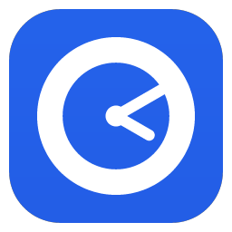

# PunchPoint

A modern replacement for **Acroprint timeQplus v3** on Windows 11 — a PC time clock
for small businesses, with a one-click import of your existing timeQplus employees
and punches.



## Why

timeQplus v3 (2012) depends on components Windows 11 no longer ships — 32-bit JET/MDAC
drivers, old VB6 runtime OCXs, Windows Help. On Windows 11 it installs but misbehaves,
and Acroprint no longer supports it.

PunchPoint is a standalone Windows app that:

* runs on Windows 11 (x64 and ARM64) with **no installs, no runtime, no database engine** —
  a single `PunchPoint.exe`;
* **imports your existing data** directly from `arx_active.mdb`, the timeQplus database,
  with no export step and no Access installed;
* keeps the workflow your employees already know: type a PIN, press Clock In / Clock Out;
* gives you honest, explainable time cards: every adjustment (rounding, grace, docking,
  lunch, overtime) is shown in plain English.

## What it does

| Area | |
|---|---|
| **Clock** | Big PIN pad, clock in/out, optional unpaid breaks, recent activity, auto-return |
| **Dashboard** | Who is on the clock now, hours this period, punch problems |
| **Employees** | Profiles, PIN/badge, shift assignment, pay type and rate, active/inactive |
| **Time Cards** | Per-employee, per-period totals, day-by-day breakdown, corrections, approval |
| **Punches** | Every raw clock event, editable, with audit trail |
| **Import** | Reads timeQplus `arx_active.mdb` directly; previews before writing |
| **Reports** | Payroll CSV, daily detail CSV, punch CSV, printable time cards |
| **Settings** | Pay periods, rounding, overtime, day-change, shifts, holidays, backups |

## Install and run

1. Copy `PunchPoint.exe` to the work PC (Desktop, or `C:\PunchPoint`).
2. Double-click it. No installer and no admin rights are required.
3. Your data lives in `C:\ProgramData\PunchPoint\`:
   * `punchpoint.db` — the database (SQLite)
   * `Backups\` — a copy is made once a day and before every import
   * `Logs\` — error logs, if anything ever goes wrong

To start PunchPoint automatically, right-click the exe → *Send to* → *Desktop (create shortcut)*,
then move the shortcut into `shell:startup` (Win+R → `shell:startup`).

## Importing from timeQplus

1. Open **Import**.
2. Press **Find it** — PunchPoint looks for the database in the usual places:
   `C:\ProgramData\Acroprint\timeQplusV3\Data\arx_active.mdb`
   (older installs: `C:\Program Files\Acroprint\timeQplusV3\Data\`).
   If the old software is on another PC, copy its whole `timeQplusV3` folder to this PC first.
3. Check the preview: employee list, punch counts, date range, and how IN/OUT was detected.
4. Press **Start import**. A backup is taken first, and running it twice is safe.

What is imported: employees (name, PIN, badge, number, hire date, custom fields),
all punches, shifts, pay periods, paid holidays, company overtime/rounding rules, and
time-card approvals. See [docs/import-notes.md](docs/import-notes.md) for the details,
including the one judgement call (punch direction) and how it is detected.

If you only have exported text files rather than the database, they can be imported too —
open **Import** and choose the CSV/TXT file.

## Differences from timeQplus

* No terminal/fingerprint hardware support — this build is for clocking in at the PC.
  Every employee gets a PIN and/or badge number, exactly like the PC screen in the old app.
* The old "supervisor" accounts are replaced by a single optional supervisor PIN
  (Settings → Company) that gates the management screens.
* Overtime is computed from your configured rules every time, rather than being stored;
  the old manual "carry" fields are not carried forward. Manual corrections are done with
  **Adjust hours** on the Time Cards screen.

## Building

Requires the .NET SDK 11 (or 10 with the target framework changed to `net10.0-windows`).
The app cross-compiles from macOS or Linux.

```bash
# tests
dotnet test

# a single self-contained exe for Windows x64
dotnet publish src/PunchPoint.App -c Release -r win-x64 --self-contained true \
  -p:PublishSingleFile=true -p:IncludeNativeLibrariesForSelfExtract=true \
  -p:EnableCompressionInSingleFile=true -o dist/win-x64

# Windows on ARM
dotnet publish src/PunchPoint.App -c Release -r win-arm64 --self-contained true \
  -p:PublishSingleFile=true -p:IncludeNativeLibrariesForSelfExtract=true \
  -p:EnableCompressionInSingleFile=true -o dist/win-arm64

# command line tools (import, verify, demo)
dotnet run --project src/PunchPoint.Cli -- demo --db /tmp/demo.db
```

Or run `./build.sh` to produce both builds in `dist/`.

## Project layout

```
src/PunchPoint.Core    cross-platform engine: Jet 4 reader, time-card maths, storage, import, export
src/PunchPoint.App     WinForms UI (net11.0-windows)
src/PunchPoint.Cli     console tools: inspect/import/verify
tests/                 xUnit tests + a synthetic timeQplus database fixture
tools/                 fixture generator, icon generator, build script
docs/                  user guide, import notes, architecture
```

The Jet 4 reader is written from the published page layout (with reference to the
Apache-2.0 licensed Jackcess project); it deliberately avoids the Microsoft Access
Database Engine, which is exactly the dependency that breaks on modern Windows.
